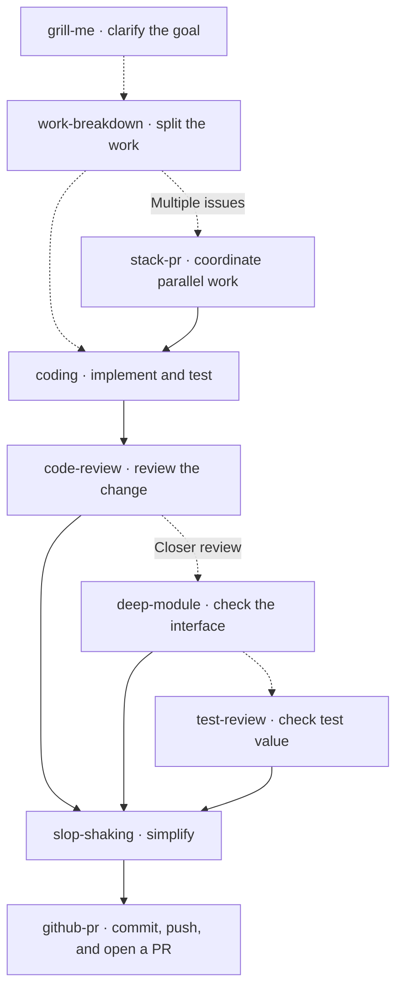

# ghosts

The agent skills I use for engineering, product, research, writing, and everyday tools.

## How I use them

A typical engineering path, with skills chosen as needed. I clarify the goal
and break down larger tasks before implementing, reviewing, simplifying, and
publishing. Dashed arrows show optional paths; I fix findings and rerun relevant
checks before publishing.



When I want to understand a change, I use `pr-tour` to follow the real diff or
`explain-diff` for public-interface changes and usage examples, optionally as a visual lesson. `eli5` explains unfamiliar topics, and
`cram` turns study material into a quiz.

## Install

```sh
npx @solaqua/skul@latest add --global sjquant/ghosts --all
```

Or install the published [`@solaqua/ghosts`](https://www.npmjs.com/package/@solaqua/ghosts) package:

```sh
npx @solaqua/skul@latest add --global npm:@solaqua/ghosts --all
```

Requires Node.js >=20 and git. `--all` installs every bundle; `--global` installs skills at the user level. Skul targets all supported agents by default. Use `--agent <name>` to choose an agent, or repeat it to choose several.

## Skills

Skills maintained here use the `ghosts:` prefix. For example, invoke
`$ghosts:code-review` in Codex or `/ghosts:code-review` in Claude Code.
For installation selectors, use the source path, such as `--include skills/code-review`.

### Engineering

| Skill | What it helps with |
| --- | --- |
| [coding](engineering/skills/coding/SKILL.md) | Keep implementation simple and tests focused on meaningful behavior. |
| [code-review](engineering/skills/code-review/SKILL.md) | Review correctness, downstream contracts, design, and complexity; verify material safety assumptions without editing the change. |
| [test-review](engineering/skills/test-review/SKILL.md) | Find missing test protection and tests that cost more than they protect. |
| [deep-module](engineering/skills/deep-module/SKILL.md) | Check whether a module hides complexity behind a simple interface. |
| [verify-journeys](engineering/skills/verify-journeys/SKILL.md) | Verify real user journeys and report observable outcomes, evidence, and coverage gaps. |
| [benchmark-checklist](engineering/skills/benchmark-checklist/SKILL.md) | Check performance claims for equivalent work, experimental control, and repeatability. |
| [slop-shaking](engineering/skills/slop-shaking/SKILL.md) | Remove unnecessary code, content, structure, and UI elements. |
| [grill-me](engineering/skills/grill-me/SKILL.md) | Stress-test a plan or idea through focused questions. |
| [work-breakdown](engineering/skills/work-breakdown/SKILL.md) | Break a goal into reviewable work packages with dependencies and execution order. |
| [task-handoff](engineering/skills/task-handoff/SKILL.md) | Prepare concise handoffs for independent implementation tasks. |
| [delegate](engineering/skills/delegate/SKILL.md) | Hand work to another Orca agent or supervise it through completion with a concise brief. |
| [github-issue](engineering/skills/github-issue/SKILL.md) | Create or update GitHub issues, sub-issues, and dependencies. |
| [github-pr](engineering/skills/github-pr/SKILL.md) | Commit and push changes, then create or update their pull request. |
| [stack-pr](engineering/skills/stack-pr/SKILL.md) | Implement GitHub issues in parallel and build stacked PRs in dependency order. |
| [explain-diff](engineering/skills/explain-diff/SKILL.md) | Explain public-interface changes read-only with before/after usage examples, compatibility impact, and optional visual HTML lessons. |
| [write-adr](engineering/skills/write-adr/SKILL.md) | Record an engineering decision, its context, and its rationale. |
| [write-glossary](engineering/skills/write-glossary/SKILL.md) | Define project terms and establish a shared vocabulary in `GLOSSARY.md`. |

### Product

| Skill | What it helps with |
| --- | --- |
| [ui-design](product/skills/ui-design/SKILL.md) | Explore visual references and image mockups, refine a direction, and deliver design documentation or UI implementation. |
| [value-first](product/skills/value-first/SKILL.md) | Review websites, UX, and READMEs for clear value, brand appeal, trust, and low cognitive load. |

### Research and writing

| Skill | What it helps with |
| --- | --- |
| [deep-research](research/skills/deep-research/SKILL.md) | Investigate a question, test competing explanations, and support conclusions with sources. |
| [cold-reader](writing/skills/cold-reader/SKILL.md) | Write engineering documents that make sense without the preceding conversation. |
| [rewrite](writing/skills/rewrite/SKILL.md) | Shorten and clarify a prompt while preserving every instruction that affects the result. |
| [make-skill](writing/skills/make-skill/SKILL.md) | Create or revise a skill with only the instructions needed for its intended behavior. |
| [eli5](writing/skills/eli5/SKILL.md) | Explain a topic to a beginner through a self-contained visual HTML lesson. |
| [humanize-korean](writing/skills/humanize-korean/SKILL.md) | Smooth mechanical Korean phrasing while preserving meaning, facts, and tone. |

### Tools

| Skill | What it helps with |
| --- | --- |
| [vibe-notion](tools/skills/vibe-notion/SKILL.md) | Manage Notion pages, databases, blocks, users, and comments through the CLI. |

### External skills

These are installed from pinned upstream sources in [the registry](registry/skul.refs.json) and keep their upstream names, without `ghosts:`.

| Skill | What it helps with |
| --- | --- |
| [ego-browser](https://github.com/citrolabs/ego-lite) | Automate browser tasks and web app checks in ego lite using your existing logins. |
| [context7-cli](https://github.com/upstash/context7) | Fetch current library documentation and manage Context7 skills and configuration. |
| [insane-search](https://github.com/fivetaku/insane-search) | Retrieve public web content through alternative access methods when ordinary fetching fails. |
| [obsidian-cli](https://github.com/kepano/obsidian-skills) | Search and manage Obsidian notes, tasks, properties, and plugins. |
| [sentry-cli](https://github.com/getsentry/cli) | Inspect Sentry issues, events, projects, and organizations through the CLI. |
| [orca-cli](https://github.com/stablyai/orca) | Manage Orca worktrees, agent terminals, artifacts, and the embedded browser. |
| [cram](https://github.com/sjquant/cram/tree/7d6c596732a18348529351399014d17ba29544b2) | Turn study material into flashcards and quizzes in a standalone HTML file. |
| [pr-tour](https://github.com/YunSinLee/pr-tour/tree/95a634f42fc655bcb89f652d2a734c32a61952ae) | Create an HTML reading guide that follows a PR's code flow and real diff. |

## Upstream sources

| Local component | Upstream | Pinned revision | License |
| --- | --- | --- | --- |
| `writing/skills/humanize-korean/references` | [`epoko77-ai/im-not-ai`](https://github.com/epoko77-ai/im-not-ai), `skills/humanize-korean/references` | [`9747f03`](https://github.com/epoko77-ai/im-not-ai/tree/9747f036cdc28a1a8aea4dc71fef1f7846eb96f7); selected rule and comma-metric fixes from [`b37e020`](https://github.com/epoko77-ai/im-not-ai/tree/b37e0206d31fffd9149bf57168d4d62eb2086bee) | MIT |
| `tools/skills/vibe-notion` | [`devxoul/vibe-notion`](https://github.com/devxoul/vibe-notion), `skills/vibe-notion` | [`89c6643`](https://github.com/devxoul/vibe-notion/tree/89c6643cebb4e4c56bbde826b6557da77f9d9d2f) | MIT, declared in the upstream README |
