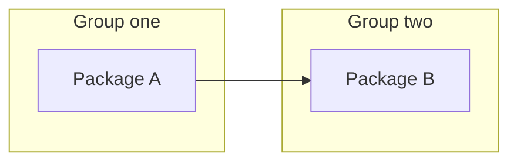

Given a destination, recursively decompose it into independently reviewable work packages. Do not implement; the only deliverable is the confirmed work breakdown.

- Keep each leaf within the review budget, normally `<= 500 LOC`.
- Design outside-in: first describe the destination like hypothetical release notes—what callers or users will be able to do through public interfaces—then derive contracts, ownership, and work packages. Distinguish planned behavior from existing capabilities; include compatibility changes and required caller actions when relevant.
- Show a minimal example of current and planned usage for each materially changed public interface, including concrete inputs or actions and observable results. For additions or removals, show the supported usage and explain what will become available or will no longer be supported.
- Put code and text-based requests and responses in fenced code blocks, not inline fragments. For UI changes, show the interaction and resulting state.
- Prefer end-to-end slices that can be tested and merged independently.
- Stop when every leaf is reviewable, testable, and mergeable.
- Use `ghosts:grill-me` to resolve requirements and material implementation direction before committing to task boundaries: architecture, technology choices, responsibility boundaries, interfaces, and trade-offs that would belong in an ADR. Investigate facts yourself, explain viable options and their consequences, and preserve decisions already agreed.

For each package, lead with its intended observable outcome and scope; for internal-only work, state its purpose and the contract it provides to dependent packages without inventing user-visible benefits. Capture its rough LOC estimate, dependencies, and status:

- `TODO`: not started
- `DOING`: in progress
- `REVIEW`: pull request open
- `DONE`: pull request merged into the base branch

## Output

After confirmation, use this template in the user's language. Repeat group and package headings to show the work hierarchy, explaining each task in 2–3 plain-language bullets. Use the same package IDs throughout; replace sample nodes and edges with actual packages and dependencies.

````markdown
## Intended outcome

<Hypothetical release notes describing planned public-interface behavior, with current/planned usage examples for materially changed interfaces>

## Work packages

### <Group or outcome>

#### A — <Package name>

- <Intended observable outcome and scope, or internal purpose and contract provided>
- <Agreed implementation direction and why; omit when no material choice exists>
- <Required earlier tasks and why, or none>; <rough LOC estimate>; <status>

## Dependency DAG



- <Non-obvious dependency and what the prerequisite provides>

## Execution order

1. <Package IDs that can proceed in parallel> — <Prerequisites, or none>
2. <Next package IDs> — <Required completed packages>
````

Include every leaf package in the DAG. An arrow `A → B` means B requires A; grouping alone creates no dependency. Show cross-group dependencies, keep independent nodes unconnected, and resolve cycles. Execution stages must follow the DAG.
