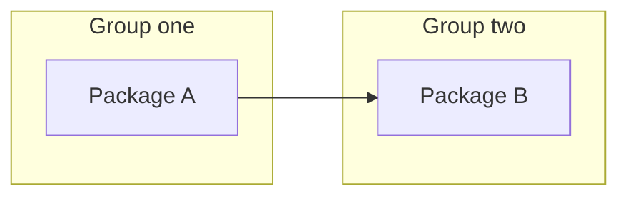

Given a destination, recursively decompose it into independently reviewable work packages. Do not implement; the only deliverable is the confirmed work breakdown.

- Keep each leaf within the review budget, normally `<= 1000 LOC`.
- Define the upper-layer interface before decomposing its children.
- Prefer end-to-end slices that can be tested and merged independently.
- Stop when every leaf is reviewable, testable, and mergeable.
- Use `ghosts:grill-me` to resolve material design or decomposition trade-offs with the user. Investigate facts yourself and preserve decisions already agreed.

For each package, capture its scope, rough LOC estimate, dependencies, and status:

- `TODO`: not started
- `DOING`: in progress
- `REVIEW`: pull request open
- `DONE`: pull request merged into the base branch

## Output

After confirmation, use this template in the user's language. Repeat group headings to show the work hierarchy. Use the same package IDs in the tables, DAG, and execution stages. Replace the sample nodes and edge with the actual packages and dependencies.

````markdown
## Work packages

### <Group or outcome>

| ID | Package and scope | Est. LOC | Depends on | Status |
| --- | --- | --- | --- | --- |
| A | <Package and scope> | <Estimate> | — | TODO |

## Dependency DAG



- <Non-obvious dependency and what the prerequisite provides>

## Execution order

1. <Package IDs that can proceed in parallel> — <Prerequisites, or none>
2. <Next package IDs> — <Required completed packages>
````

Include every leaf package in the DAG. An arrow `A → B` means B requires A; grouping alone creates no dependency. Show cross-group dependencies, keep independent nodes unconnected, and resolve cycles. Execution stages must follow the DAG.
